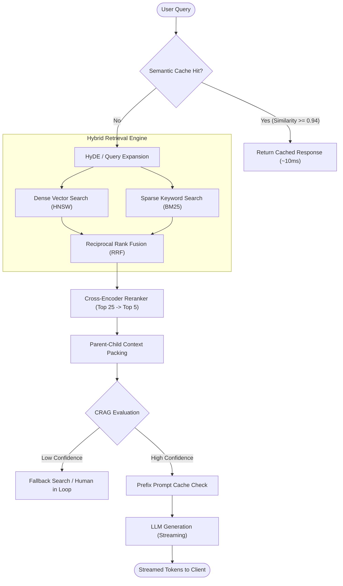

<div align="center">

  <h1>🧠 LLM System Patterns</h1>

  <p><strong>Production design patterns, latency budgets, failure modes, and architectural trade-offs for building real-world LLM systems, RAG pipelines, and autonomous AI agents.</strong></p>

  <p>
    
    
    
    
  </p>

  <p>
    <a href="#-the-8-core-production-patterns"></a>
    <a href="#-production-latency--cost-budgets"></a>
    <a href="#-the-production-disaster-manual"></a>
    <a href="#-real-world-case-studies"></a>
    
  </p>

  <sub>Star ⭐ this repository to bookmark this architecture handbook for technical interviews and production design!</sub>

</div>

---

## 📑 Table of Contents

- [💡 Why LLM System Patterns?](#-why-llm-system-patterns)
- [🧩 The 8 Core Production Patterns](#-the-8-core-production-patterns)
  - [1. Hybrid Retrieval & Reciprocal Rank Fusion (RRF)](#1-hybrid-retrieval--reciprocal-rank-fusion-rrf)
  - [2. Hypothetical Document Embeddings (HyDE)](#2-hypothetical-document-embeddings-hyde)
  - [3. Two-Tier Semantic Caching & Token Routing](#3-two-tier-semantic-caching--token-routing)
  - [4. Hierarchical Parent-Child Chunking](#4-hierarchical-parent-child-chunking)
  - [5. Self-Corrective RAG (CRAG) & Active Guardrails](#5-self-corrective-rag-crag--active-guardrails)
  - [6. Stateful Multi-Agent Supervisor & Tool Calling](#6-stateful-multi-agent-supervisor--tool-calling)
  - [7. Prompt Prefix Caching & TTFT Optimization](#7-prompt-prefix-caching--ttft-optimization)
  - [8. Vector Index Selection: HNSW vs. IVFFlat vs. DiskANN](#8-vector-index-selection-hnsw-vs-ivfflat-vs-diskann)
- [⏱️ Production Latency & Cost Budgets](#️-production-latency--cost-budgets)
- [🚨 The Production Disaster Manual (Failure Modes & Fixes)](#-the-production-disaster-manual-failure-modes--fixes)
- [💻 Runnable 50-Line Python Primitives](#-runnable-50-line-python-primitives)
- [🎯 Real-World System Design Case Studies](#-real-world-system-design-case-studies)
  - [Case Study 1: Real-Time Multimodal AI Academic Engine](#case-study-1-real-time-multimodal-ai-academic-engine)
  - [Case Study 2: Hardened Sandboxed Code Execution Agent](#case-study-2-hardened-sandboxed-code-execution-agent)
  - [Case Study 3: Low-Latency Financial Order Intelligence Engine](#case-study-3-low-latency-financial-order-intelligence-engine)
- [⭐ Explore My Other Repositories](#-explore-my-other-repositories)
- [🤝 Contributing](#-contributing)
- [📜 License](#-license)

---

## 💡 Why LLM System Patterns?

Traditional software engineering operates on deterministic state transitions and well-defined API contracts. In contrast, **LLM architectures are probabilistic, token-metered, and latency-heavy**. 

Moving from a prototype script to a production service with 99.9% uptime requires answering real engineering questions:
* *How do we handle out-of-vocabulary acronyms and serial numbers that vector embeddings miss?*
* *How do we keep end-to-end Time to First Token (TTFT) under $300\text{ms}$ while performing vector search and reranking?*
* *How do we avoid catastrophic context window overflows and save 85% on model token billing?*

This repository documents the battle-tested architectural patterns, real mathematical budgets, and failure recovery protocols required to build scalable AI systems.

---

## 🧩 The 8 Core Production Patterns



---

### 1. Hybrid Retrieval & Reciprocal Rank Fusion (RRF)

#### The Problem
Pure dense vector search (cosine similarity on embedding vectors) excels at conceptual understanding (e.g., matching *"feline medical issues"* with *"sick cat"*), but completely fails on exact keyword lookups: serial numbers, product SKUs, function names (`calculate_apr()`), and rare acronyms.

#### The Pattern
Combine **Dense Vector Search (HNSW)** with **Sparse Keyword Search (BM25 / SPLADE)** in parallel, then merge rankings using **Reciprocal Rank Fusion (RRF)**:

$$RRF\_Score(d \in D) = \sum_{m \in M} \frac{1}{k + rank_m(d)}$$

Where:
* $M$ is the set of rankers (Dense + Sparse).
* $rank_m(d)$ is the position of document $d$ in system $m$.
* $k$ is a smoothing constant (standard industry default: $k = 60$).

```python
def reciprocal_rank_fusion(dense_ranks: list[str], sparse_ranks: list[str], k: int = 60) -> list[tuple[str, float]]:
    scores = {}
    for rank, doc_id in enumerate(dense_ranks):
        scores[doc_id] = scores.get(doc_id, 0.0) + (1.0 / (k + rank + 1))
    for rank, doc_id in enumerate(sparse_ranks):
        scores[doc_id] = scores.get(doc_id, 0.0) + (1.0 / (k + rank + 1))
    return sorted(scores.items(), key=lambda item: item[1], reverse=True)
```

---

### 2. Hypothetical Document Embeddings (HyDE)

#### The Problem
User queries are often terse and underspecified (e.g., *"error 403 on s3 bucket policy"*). Embedding a short 6-word query produces a vector that lives in a different sub-manifold than a comprehensive 500-word documentation page.

#### The Pattern
1. Instruct a fast, cheap SLM (Small Language Model like Llama-3-8B or Gemini-Flash) to generate a **hypothetical answer** to the query.
2. Embed the *hypothetical answer* rather than the raw query.
3. Use that rich dense embedding to search the vector index. The hypothetical answer is syntactically and semantically closer to the true target passage.

---

### 3. Two-Tier Semantic Caching & Token Routing

#### The Problem
$30\text{--}40\%$ of incoming user requests in customer-facing applications are semantically identical (e.g., *"How do I reset my password?"* vs *"Where to change password"*). Routing every request to an LLM wastes API budget and adds $500\text{ms}\text{--}2000\text{ms}$ of unnecessary latency.

#### The Pattern
Implement a two-tier cache before the retrieval engine:
1. **Tier 1 (Exact Match):** In-memory SHA-256 hash lookup ($O(1)$, $<1\text{ms}$).
2. **Tier 2 (Semantic Match):** High-dimensional index lookup in Redis/Qdrant. If cosine similarity $S_C(\vec{v}_{query}, \vec{v}_{cached}) \ge \tau$ (where $\tau \approx 0.94$), return the cached completion directly.

---

### 4. Hierarchical Parent-Child Chunking

#### The Problem
* **Small Chunks ($128$ tokens):** Optimal for embedding similarity (high signal-to-noise ratio), but strip away surrounding contextual nuance needed by the generator.
* **Large Chunks ($1024$ tokens):** Contain sufficient context for generation, but average out specific embeddings, resulting in poor retrieval accuracy.

#### The Pattern
Decouple the **retrieval index** from the **generation payload**:
1. Split documents into large **Parent Chunks** ($1024$ tokens).
2. Subdivide each parent into 4–8 small **Child Chunks** ($128$ tokens) with a reference ID pointing to the parent.
3. Search and match child chunks against user queries.
4. When a child chunk matches, pass its **full parent chunk** into the LLM context window.

---

### 5. Self-Corrective RAG (CRAG) & Active Guardrails

#### The Problem
Naive RAG blindly feeds retrieved documents into the LLM even when retrieval confidence is low, leading directly to hallucinated responses.

#### The Pattern
Implement an autonomous evaluation loop prior to synthesis:
1. **Confidence Evaluator:** A lightweight classification step evaluates whether retrieved passages directly contain sufficient information to answer the prompt.
2. **Three-Way Branching:**
   * **Correct:** High confidence $\rightarrow$ Proceed to LLM generator with prompt caching.
   * **Ambiguous:** Medium confidence $\rightarrow$ Strip irrelevant sentences via passage filtering + synthesize with hedge language.
   * **Incorrect:** Low confidence $\rightarrow$ Trigger fallback search (external web search API or human-in-the-loop escalation).

---

### 6. Stateful Multi-Agent Supervisor & Tool Calling

#### The Problem
Monolithic single-agent loops with 30+ available tools suffer from tool confusion, hallucinated arguments, and catastrophic context window drift over multi-turn execution.

#### The Pattern
Split the system into a **Hierarchical Supervisor Architecture**:
* **Supervisor / Router:** Classifies user intent and delegates work to isolated specialized agents (`DatabaseAgent`, `CodingAgent`, `SummarizerAgent`).
* **Specialized Workers:** Hold strict, narrow tool definitions ($3\text{--}5$ tools maximum) and run in isolated execution envelopes.
* **Global Memory Checkpoint:** A central state-machine (Redis/PostgreSQL) tracks cycle counts and enforces hard termination thresholds to prevent runaway infinite loops.

---

### 7. Prompt Prefix Caching & TTFT Optimization

#### The Problem
Modern agentic workflows append extensive system prompts, tool schemas, and document chunks on every turn. Re-encoding 20k tokens on every request destroys Time to First Token (TTFT) and inflates billing.

#### The Pattern
Structure prompt templates strictly to maximize **Prefix Caching** compatibility (Anthropic Prompt Caching & OpenAI Cached Tokens):
* **Order matters:** Always place **100% static content first** (System Prompt $\rightarrow$ Tool Schemas $\rightarrow$ Few-Shot Examples $\rightarrow$ Invariant Documentation).
* Place **dynamic content last** (Chat History $\rightarrow$ User Query).
* Result: Providers recognize identical prefix byte blocks, delivering up to **90% cost discounts** and sub-$200\text{ms}$ TTFT.

---

### 8. Vector Index Selection: HNSW vs. IVFFlat vs. DiskANN

| Index Type | Search Latency | RAM Consumption | Build Time | Best Suited For |
| :--- | :--- | :--- | :--- | :--- |
| **Flat (Exact)** | $O(N)$ (Slow, $>150\text{ms}$) | Low (No graph overhead) | $0\text{s}$ | Datasets $<10{,}000$ vectors |
| **IVFFlat (Inverted File)** | $O(\sqrt{N})$ ($10\text{--}30\text{ms}$) | Medium (Centroid lists) | Fast | Up to $1\text{M}$ vectors with tight RAM |
| **HNSW (Hierarchical Navigable Small World)** | $O(\log N)$ ($2\text{--}6\text{ms}$) | **High** ($1.5\times\text{--}2\times$ raw vector size) | Moderate | Production real-time apps ($<10\text{M}$ vectors) |
| **DiskANN / Vamana** | $O(\log N)$ ($10\text{--}20\text{ms}$) | **Ultra-Low** (Graph on NVMe SSD) | Heavy | Massive scale ($10\text{M}\text{--}1\text{B}+$ vectors) |

---

## ⏱️ Production Latency & Cost Budgets

### The Sub-300ms End-to-End Latency Waterfall
For real-time user experiences, modern production systems must adhere to a strict latency budget:

```
[Client Request]
       │
       ├── (1) Semantic Cache Check:     ~8ms
       ├── (2) Query Embedding (API):    ~25ms
       ├── (3) HNSW Vector Index Search: ~6ms
       ├── (4) BM25 Keyword Search:      ~4ms
       ├── (5) Cross-Encoder Rerank:     ~45ms
       ├── (6) Context Assembly & Token: ~5ms
       └── (7) LLM Time to First Token:  ~180ms  (With Prompt Caching)
────────────────────────────────────────────────────────
Total End-to-End TTFT:                  ~273ms  ✅ [PASS]
```

### The Cost Reduction Rule of Thirds
1. **Tier 1 - Semantic Caching:** Eliminates $30\%$ of redundant API calls.
2. **Tier 2 - Model Tiering (Router):** Routes $60\%$ of simple user turns to small models ($0.15\$/1\text{M}$ tokens) and only $10\%$ of complex reasoning to frontier models ($3.00\$/1\text{M}$ tokens).
3. **Tier 3 - Context Pruning:** Eliminates irrelevant chunks via Cross-Encoder thresholds before generation, saving $40\%$ of prompt token volume.

---

## 🚨 The Production Disaster Manual (Failure Modes & Fixes)

### 1. The "Lost in the Middle" Phenomenon
* **Symptom:** LLMs accurately attend to information placed at the very beginning or very end of a context window, but retrieval accuracy drops by up to $40\%$ when critical facts reside in the middle of a $32\text{k}+$ token context.
* **Production Fix:** Implement **Reversed-Rank Packing**: Place the highest-ranked chunk at the very beginning of the prompt, the second-highest at the very end, and less relevant chunks in the center.

### 2. Chunk Boundary Truncation
* **Symptom:** An essential fact (e.g., *"Patient was prescribed 50mg Sertraline after exhibiting tremors."*) is split across chunk boundaries (Chunk A ends with *"prescribed 50mg"*, Chunk B starts with *"Sertraline"*), ruining embedding cosine distance.
* **Production Fix:** Enforce a minimum **$15\text{--}20\%$ sliding window overlap** and evaluate chunk boundaries strictly on sentence/paragraph AST tokens rather than arbitrary character lengths.

### 3. Vector Drift & Model Incompatibilities
* **Symptom:** Upgrading from `text-embedding-3-small` to `text-embedding-3-large` or changing dimensionalities breaks similarity scores silently.
* **Production Fix:** Never store raw embeddings without immutable metadata headers: `{"model": "text-embedding-3-small", "dim": 1536, "version": "v1.2"}`. Enforce blue-green re-indexing pipelines before flipping production query traffic.

---

## 💻 Runnable 50-Line Python Primitives

### Minimalist Pure NumPy Vector Search Engine
Zero heavy dependencies. Demonstrates exact cosine distance vector retrieval:

```python
import numpy as np

class MiniVectorDB:
    def __init__(self, dimension: int):
        self.dim = dimension
        self.vectors = np.empty((0, dimension), dtype=np.float32)
        self.metadata = []

    def insert(self, vector: list[float], meta: dict):
        vec = np.array(vector, dtype=np.float32)
        norm = np.linalg.norm(vec)
        normalized = vec / (norm if norm > 0 else 1.0)
        self.vectors = np.vstack([self.vectors, normalized])
        self.metadata.append(meta)

    def search(self, query_vector: list[float], top_k: int = 3) -> list[tuple[dict, float]]:
        if len(self.vectors) == 0:
            return []
        q = np.array(query_vector, dtype=np.float32)
        q_norm = q / (np.linalg.norm(q) if np.linalg.norm(q) > 0 else 1.0)
        
        # Vectorized dot product for cosine similarities
        similarities = np.dot(self.vectors, q_norm)
        top_indices = np.argsort(similarities)[::-1][:top_k]
        
        return [(self.metadata[i], float(similarities[i])) for i in top_indices]

# Test it in 2 seconds
if __name__ == "__main__":
    db = MiniVectorDB(dimension=3)
    db.insert([1.0, 0.0, 0.0], {"doc": "Document about Database Systems"})
    db.insert([0.0, 1.0, 0.0], {"doc": "Document about Neural Networks"})
    db.insert([0.9, 0.1, 0.0], {"doc": "Document about Distributed Storage"})

    results = db.search([1.0, 0.05, 0.0], top_k=2)
    for meta, score in results:
        print(f"[{score:.4f}] {meta['doc']}")
```

---

## 🎯 Real-World System Design Case Studies

### Case Study 1: Real-Time Multimodal AI Academic Engine
*Inspired by the architecture of [Florix AI](https://github.com/Gana-Y/Florix_AI).*
* **System Goal:** Ingest textbooks, PDFs, and YouTube transcripts to generate adaptive spaced-repetition quizzes and real-time interactive viva defenses with sub-$200\text{ms}$ query response times.
* **Architecture:**
  * Ingestion worker breaks documents into semantically coherent section nodes stored in PostgreSQL across $15+$ relational tables.
  * ChromaDB HNSW dense index handles semantic similarity with fallback to SQLite in local developer mode.
  * Async rate-limiting via SlowAPI prevents token exhaustion during simultaneous multi-user viva sessions.

### Case Study 2: Hardened Sandboxed Code Execution Agent
*Inspired by the architecture of [vesper-engine](https://github.com/Gana-Y/vesper-engine).*
* **System Goal:** Safely evaluate and execute arbitrary code generated by autonomous LLM agents in under $10\text{ms}$ with strict security envelopes.
* **Architecture:**
  * Linux `cgroups v2` enforce absolute memory caps ($128\text{MB}$) and strict CPU cycle budgets.
  * Seccomp filter blocks dangerous system calls (`ptrace`, unauthorized socket binds, filesystem escapes).
  * High-resolution sub-millisecond telemetry records exact execution timing and memory high-water marks.

### Case Study 3: Low-Latency Financial Order Intelligence Engine
*Inspired by the architecture of [OrderCore](https://github.com/Gana-Y/OrderCore).*
* **System Goal:** Process real-time market streams, execute order-book cancellations with $O(1)$ amortized latency, and run AI natural-language order queries concurrently.
* **Architecture:**
  * High-performance dual-heap matching engine processes $136{,}000\text{ orders/sec}$ at $4.3\mu\text{s}$ execution latency.
  * Python AsyncIO event loop handles bidirectional WebSocket streams while decoupled AI background workers query the order book telemetry asynchronously.

---

## ⭐ Explore My Other Repositories

| Repository | Description | Domain |
| :--- | :--- | :--- |
| 🚀 [**Florix_AI**](https://github.com/Gana-Y/Florix_AI) | Production-grade multimodal AI study platform with in-database RAG, adaptive spaced repetition, and interactive viva defenses. | `Full-Stack RAG / AI` |
| ⚡ [**vesper-engine**](https://github.com/Gana-Y/vesper-engine) | Hardened, high-performance sandboxed code execution engine & online judge arbiter enforcing Linux cgroups and microsecond telemetry. | `Systems / Linux / Python` |
| 📈 [**OrderCore**](https://github.com/Gana-Y/OrderCore) | High-throughput Limit Order Book & matching engine in Python (FastAPI/WebSockets) achieving 136k orders/sec with $4.3\mu\text{s}$ latency. | `Low-Latency Systems / FinTech` |
| 🎓 [**Free-Courses**](https://github.com/Gana-Y/Free-Courses) | Curated catalog of verified 100% free technical courses & certifications from NVIDIA, Anthropic, AWS, Google, Harvard, and MIT. | `Developer Education` |
| 📚 [**AI-ML-Notes**](https://github.com/Gana-Y/AI-ML-Notes) | Comprehensive study notes, summaries, and mathematical breakdowns across AI, ML, Deep Learning, and LLMs. | `Study Notes / AI & ML` |
| 🗺️ [**AI-ML-RoadMap**](https://github.com/Gana-Y/AI-ML-RoadMap) | The step-by-step 8-month roadmap to becoming an AI Engineer: courses, projects, habits & interview strategies. | `Career Roadmap / AI` |

---

## 🤝 Contributing

Contributions, architectural additions, and verified production benchmarks are welcome!

1. Fork the repository (`git checkout -b feature/new-pattern`).
2. Add your architectural pattern with clear diagrams, math, and code.
3. Commit with a semantic message (`git commit -m "feat: add GraphRAG community detection pattern"`).
4. Open a Pull Request.

---

## 👨‍💻 Author & Maintainer

Maintained with ❤️ by **[Ganesh Yandigeri](https://github.com/Gana-Y)**

- 🌐 **Portfolio:** [ganesh-y.vercel.app](https://ganesh-y.vercel.app)
- 💼 **LinkedIn:** [linkedin.com/in/ganesh-yandigeri](https://linkedin.com/in/ganesh-yandigeri)
- 🐙 **GitHub:** [@Gana-Y](https://github.com/Gana-Y)

---

## 📜 License

Distributed under the [MIT License](LICENSE). Feel free to learn from, use, and share!
